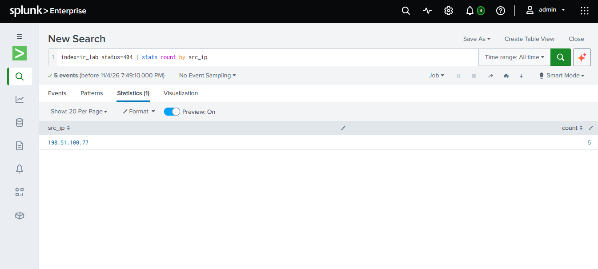
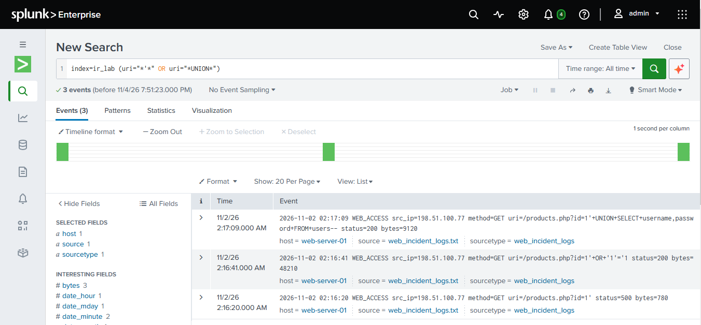
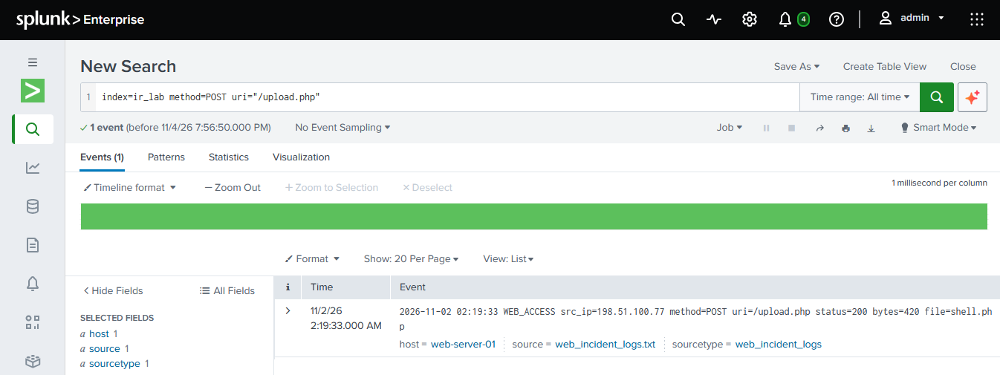
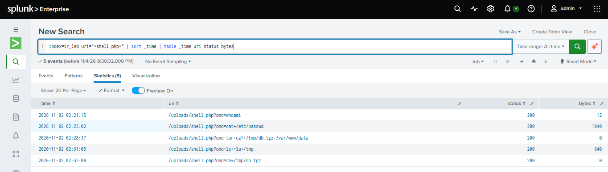
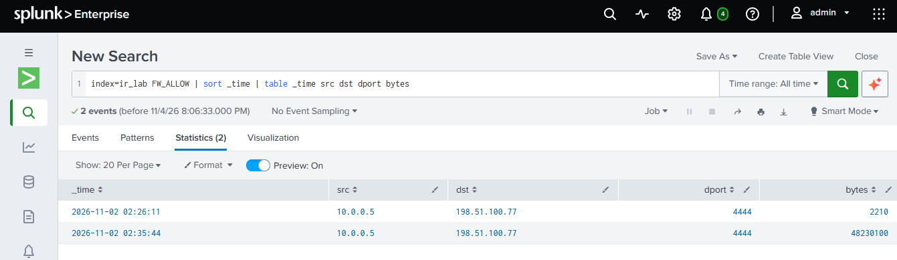
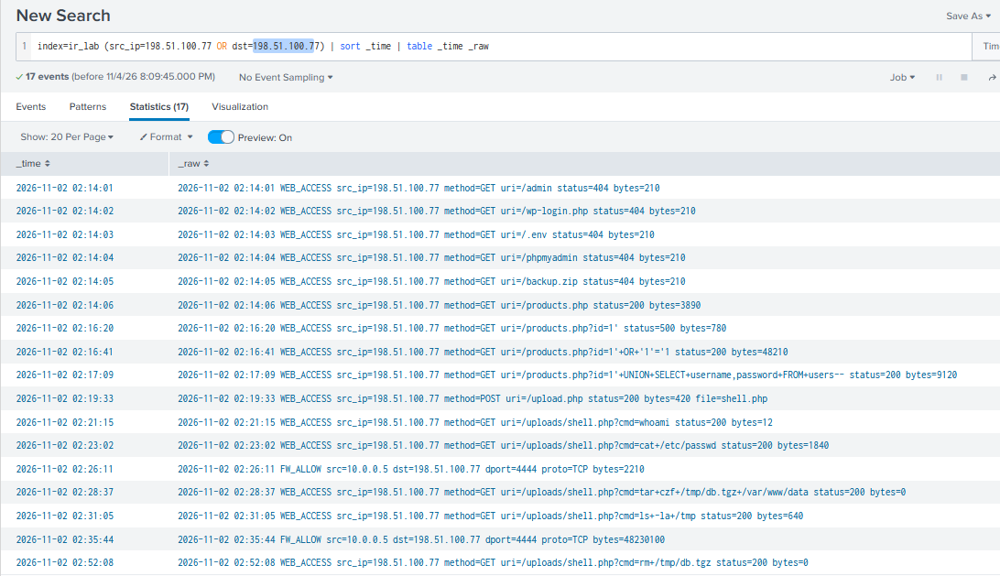

# Lab 06 — Incident Response: Web Server Compromise

## Objective
Investigate a simulated compromise of a corporate web server using Splunk,
reconstruct the attacker's timeline by correlating web and firewall logs,
and document the incident following the NIST Incident Response lifecycle.

## Security+ Objectives Covered
- 4.8 — Incident response activities
- 4.9 — Using data sources to support an investigation
- 4.4 — Security alerting and monitoring (Splunk / SIEM)
- 2.3 — Vulnerabilities (SQL injection, unrestricted file upload)
- 2.4 — Indicators of malicious activity

## Tools Used
- Splunk Enterprise (Free license)
- SPL (Search Processing Language)
- Custom dataset: web_incident_logs.txt (22 events, 2 log sources)

## Executive Summary
On 2026-11-02 between 02:14 and 02:52, an external attacker (198.51.100.77)
compromised the corporate web server. The attacker exploited a SQL injection
vulnerability, uploaded a web shell, executed commands on the server, and
very likely exfiltrated approximately 48 MB of data over TCP port 4444.
The attacker then deleted the staging archive to cover their tracks.
Severity: High.

## Log Sources
| Source | Format | Content |
|---|---|---|
| WEB_ACCESS | Web server access log | Requests to the web application |
| FW_ALLOW | Firewall log | Permitted network connections |

## Attack Timeline (2026-11-02)
| Time | Source | Event | Phase |
|---|---|---|---|
| 02:14:01 - 02:14:05 | Web | 5 requests returning 404 (/admin, /wp-login.php, /.env, /phpmyadmin, /backup.zip) | Reconnaissance |
| 02:16:20 | Web | products.php?id=1' returns 500 | Exploitation (probing) |
| 02:16:41 | Web | id=1' OR '1'='1 returns 200, 48,210 bytes (normal page: ~3,890) | Exploitation |
| 02:17:09 | Web | UNION SELECT username,password FROM users | Credential theft |
| 02:19:33 | Web | POST /upload.php, file=shell.php | Persistence (web shell) |
| 02:21:15 | Web | shell.php?cmd=whoami | Discovery |
| 02:23:02 | Web | shell.php?cmd=cat /etc/passwd | Discovery |
| 02:26:11 | Firewall | 10.0.0.5 to 198.51.100.77:4444, 2,210 bytes | Command and control (probable) |
| 02:28:37 | Web | shell.php?cmd=tar czf /tmp/db.tgz /var/www/data | Collection |
| 02:31:05 | Web | shell.php?cmd=ls -la /tmp | Verification |
| 02:35:44 | Firewall | 10.0.0.5 to 198.51.100.77:4444, 48,230,100 bytes | Exfiltration (probable) |
| 02:52:08 | Web | shell.php?cmd=rm /tmp/db.tgz | Defense evasion |

Dwell time: approximately 38 minutes. No alert or detection appears in the
provided logs.

## Investigation (SPL Queries)
Reconnaissance, requests returning 404 grouped by source IP:
`index=ir_lab status=404 | stats count by src_ip`

SQL injection attempts:
`index=ir_lab (uri="*'*" OR uri="*UNION*")`

Web shell upload:
`index=ir_lab method=POST uri="/upload.php"`

Commands executed through the web shell:
`index=ir_lab uri="*shell.php*" | sort _time | table _time uri status bytes`

Outbound connections from the server:
`index=ir_lab FW_ALLOW | sort _time | table _time src dst dport bytes`

Full attacker timeline, correlating both sources (the web log names the IP
src_ip and the firewall log names it dst, so both fields are searched):
`index=ir_lab (src_ip=198.51.100.77 OR dst=198.51.100.77) | sort _time | table _time _raw`

## Screenshots

## Analysis

### Vulnerabilities exploited
1. SQL injection in products.php: user input was inserted into the database query without validation.
2. Unrestricted file upload in upload.php: the server accepted a .php file.
   Whether upload.php required authentication cannot be determined from the logs.

### Key indicators
- A normal request to products.php returns about 3,890 bytes. The injected
  request returned 48,210 bytes (about 12x), showing the query returned far more data than intended.
- Status 200 does not mean a request was legitimate: the attacker's malicious requests mostly succeeded.
- The web shell runs with the privileges of the web server process, not root.

### Evidence limitations
- The firewall records how much data moved, not what it contained. The 48 MB
  transfer matches the archive created minutes earlier, but exfiltration is
  assessed as highly probable rather than confirmed.
- The nature of the initial 2.2 KB connection cannot be determined with the
  available logs. It is consistent with establishing a command-and-control channel.
- Confirming either would require a packet capture of the connection and
  host-level process logs.

## Indicators of Compromise (IoC)
| Type | Value |
|---|---|
| Attacker IP | 198.51.100.77 |
| Outbound port | TCP 4444 |
| Malicious file | /uploads/shell.php |
| Staging archive | /tmp/db.tgz (deleted) |
| Pattern | Burst of 404 errors from one IP in 5 seconds |

## MITRE ATT&CK Mapping
| Technique | ID |
|---|---|
| Active Scanning | T1595 |
| Exploit Public-Facing Application | T1190 |
| Web Shell | T1505.003 |
| Archive Collected Data | T1560 |
| Exfiltration Over C2 Channel | T1041 |
| File Deletion | T1070.004 |

## NIST Incident Response Phases
Note: containment, eradication and recovery are recommended actions. No real
system was modified in this lab.

### 1. Preparation
Gaps identified: no alerting on reconnaissance or injection patterns, and no
egress filtering.

### 2. Detection and Analysis
Performed in this lab: log analysis and cross-source correlation in Splunk.

### 3. Containment (recommended)
- Isolate the web server (10.0.0.5) from the network
- Block 198.51.100.77 inbound and outbound at the firewall
- Block outbound traffic to TCP 4444
- Reset all credentials stored in the users table

### 4. Eradication (recommended)
- Remove /uploads/shell.php and review the uploads directory for other files
- Fix the SQL injection using parameterized queries
- Restrict upload types and block script execution in the uploads directory

### 5. Recovery (recommended)
- Restore the server from a known clean backup
- Apply patches and monitor closely for returning activity

### 6. Lessons Learned
- Implement egress filtering: outbound connections from servers should be denied by default
- Deploy a WAF (Web Application Firewall) to block injection patterns
- Create SIEM alerts for bursts of 404 errors from one IP, POST requests to
  upload endpoints, and requests to files inside /uploads/
- Assess whether the data in /var/www/data triggers breach notification obligations

## Lessons Learned (analyst)
- Correlating multiple log sources reveals what a single source hides
- Comparing against normal values (such as bytes per response) exposes
  successful attacks that return status 200
- A good report separates confirmed facts from probable conclusions
