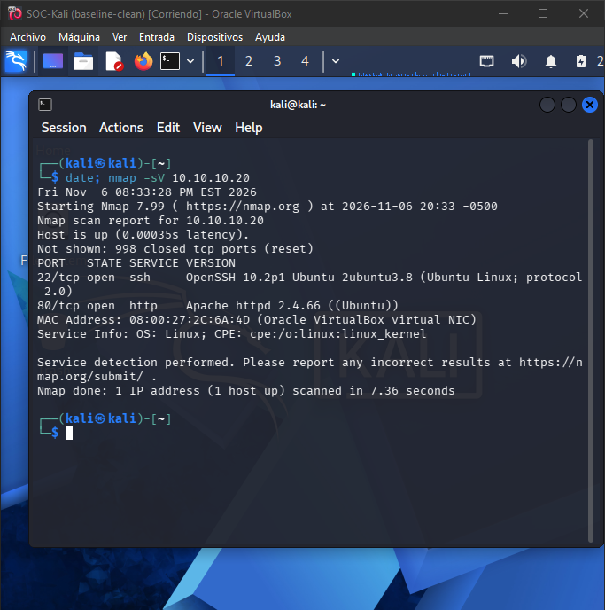
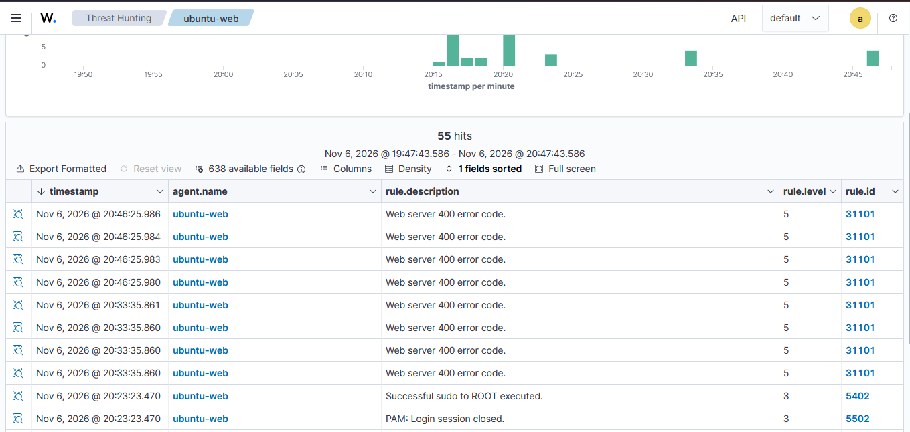
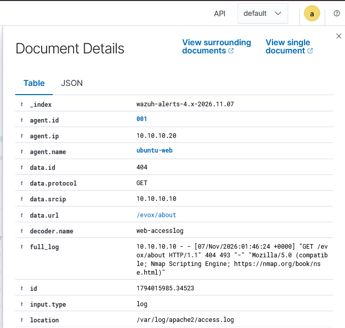
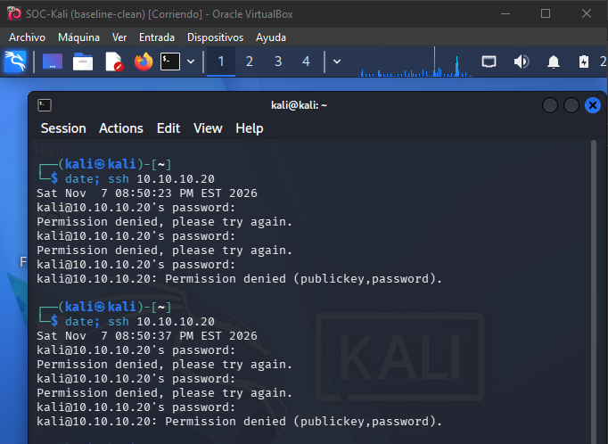
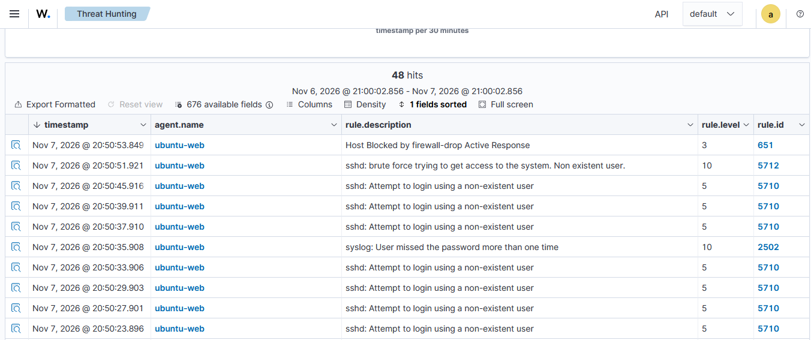
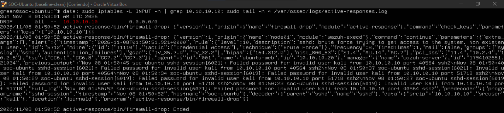
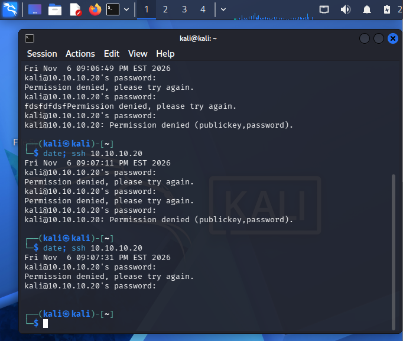
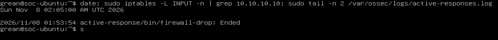

# Lab 07 — Purple Team: Attack Detection & Automated Response with Wazuh SIEM

## Summary
I built a 4-VM SOC lab in VirtualBox, attacked a Linux web server from Kali, and detected
and contained the activity with **Wazuh SIEM**. The lab covers the full incident lifecycle:
reconnaissance and brute-force attacks (red), log-based detection and alert correlation
(blue), and **automated containment** that blocked the attacker at the host firewall
2 seconds after the brute-force alert fired.

| Item | Result |
|---|---|
| Attacks simulated | Network/service reconnaissance (Nmap), SSH brute force |
| Detections | Rules 31101, 5710, 2502, 5712, 651 |
| Automated response | `firewall-drop` Active Response, attacker blocked for 180 s |
| Time from brute-force alert to block | **~2 seconds** |
| Visibility gap found | Port scanning itself is invisible to a host log agent |

## Lab Architecture

| VM | Role | OS | Isolated network IP (`SOC-LAB`) | Other NIC |
|---|---|---|---|---|
| SOC-Kali | Attacker | Kali Linux 2026.3 | 10.10.10.10 | NAT |
| SOC-Ubuntu | Victim web server + Wazuh agent | Ubuntu Server 26.04.1 | 10.10.10.20 | NAT |
| SOC-Wazuh | SIEM (manager, indexer, dashboard) | Wazuh 4.14.9 OVA | 10.10.10.30 | Host-only (dashboard) |
| SOC-Metasploitable | Secondary victim (not used in this lab) | Metasploitable 2 | 10.10.10.40 | none |

- `SOC-LAB` is a VirtualBox **internal network**: no DHCP and no route to my home network.
- The victim runs Apache 2.4.66, PHP, MariaDB, DVWA and OpenSSH.
- Host: Windows 10, Ryzen 3 3250U (4 threads), 16 GB RAM. CPU budget mattered: Wazuh was
  given 2 vCPUs, and unused VMs were saved to disk while it ran.

### Key configuration
**Wazuh agent on the victim** (`/var/ossec/etc/ossec.conf`). By default the agent reads
system logs (`auth.log`/journald) but **not** Apache, so web logs were added:
```xml
<localfile>
  <log_format>apache</log_format>
  <location>/var/log/apache2/access.log</location>
</localfile>
```

**Active Response on the Wazuh manager.** It runs the built-in `firewall-drop` command on
the agent that raised the alert, only for SSH brute-force rules:
```xml
<active-response>
  <command>firewall-drop</command>
  <location>local</location>
  <rules_id>5712,5763</rules_id>
  <timeout>180</timeout>
</active-response>
```

**Static IPs.** Netplan on Ubuntu, `/etc/network/interfaces` on Metasploitable, `nmcli` on
Kali, and `systemd-networkd` on Wazuh. On Wazuh my first config file was silently ignored:
an existing `20-eth0.network` matched the same interface and won because systemd-networkd
uses the first file in alphabetical order. Renaming mine to `10-soc-lab.network` fixed it.
`networkctl status eth1` (the `Network File:` line) showed which file was in effect.

---

## Attack 1 — Reconnaissance (MITRE T1595 Active Scanning)

**Red:** service and version scan from Kali.
```bash
nmap -sV 10.10.10.20
```
Result: `22/tcp OpenSSH 10.2p1` and `80/tcp Apache httpd 2.4.66 (Ubuntu)`. The scan took
7.36 s. Exact versions are what an attacker uses to look up known CVEs.



**Blue:** Wazuh raised **4 × rule 31101 "Web server 400 error code"** (level 5) for each
scan, all within the **same second**.



Expanding one alert identified the source and the tool:

| Field | Value | Meaning |
|---|---|---|
| `data.srcip` | `10.10.10.10` | Source is the Kali VM |
| `data.url` | `/evox/about` | A path that does not exist: Nmap probing for known products |
| `data.id` | `404` | Not found |
| User-Agent | `Nmap Scripting Engine` | The tool identified itself (IoC) |



**Analysis**
- The User-Agent is trivial to spoof, so I don't rely on it alone. The **behavior** still
  gives the scan away: 4 requests in 6 ms, all 404s, to paths that don't exist, from one IP.
  No human browses like that.
- **Visibility gap:** the port scan itself (SYN probes to 1,000 ports) generated **no
  alert**. The Wazuh agent reads application logs, and no application logs a closed-port
  probe. Only the HTTP requests sent by `-sV` were logged. Detecting the scan itself would
  need a network IDS (Suricata/Snort) feeding the SIEM.

---

## Attack 2 — SSH Brute Force (MITRE T1110 Brute Force)

**Red:** repeated failed SSH logins from Kali. Because no username was given, SSH used the
local user `kali`, which **does not exist** on the victim. That matches a real-world
pattern of attackers guessing common usernames.



**Blue: detection and correlation.** Filter used:
`rule.id:5710 or rule.id:5712 or rule.id:2502 or rule.id:651`



| Time (UTC-5) | Rule | Level | Meaning |
|---|---|---|---|
| 20:50:23 – 20:50:45 | 5710 | 5 | One alert per attempt with a non-existent user |
| 20:50:35 | 2502 | 10 | User missed the password more than once |
| 20:50:51 | **5712** | 10 | **Correlation: brute force confirmed** |
| 20:50:53 | **651** | 3 | **Host blocked by firewall-drop Active Response** |

**Blue: automated containment.** On the victim, the firewall rule and the Active Response
log show the block. The log includes rule 5712, the MITRE mapping (T1110 / Credential
Access), `srcip 10.10.10.10` and the failed logins that triggered it.



From Kali, the victim became unreachable. SSH hung with no response, because `DROP`
silently discards packets instead of rejecting them, and ping showed 100% packet loss.



**Recovery:** after the 180 s timeout, the rule was removed automatically. The block ran
at 01:50:52 UTC and the unblock finished at 01:53:54 UTC.



**Analysis**
- First attempt to brute-force alert: about 28 s. **Alert to block: about 2 s.**
- Troubleshooting note: during an earlier test, ping seemed to work while SSH was blocked,
  which contradicted a `DROP all` rule. Measuring both VMs at the same moment showed why:
  the 180 s block had **already expired** between my tests, and each new attack started a
  new block. Lesson: **gather evidence from attacker and victim at the same time** before
  drawing conclusions.

---

## Consolidated Timeline (UTC-5)

| Date / time | Event | Source |
|---|---|---|
| Nov 6, 20:33 | Nmap `-sV` scan #1 from 10.10.10.10 | Kali, Wazuh 31101 |
| Nov 6, 20:46:25 | Nmap scan #2, 4 × 404 in 6 ms | Wazuh 31101 |
| Nov 7, 20:50:23 | First failed SSH login | Kali, Wazuh 5710 |
| Nov 7, 20:50:51 | Brute force correlated | Wazuh 5712 |
| Nov 7, 20:50:53 | Attacker IP blocked at the victim firewall | Wazuh 651, iptables |
| Nov 7, 20:51:23 | Attacker ping: 100% packet loss | Kali |
| Nov 7, 20:53:54 | Block expired, rule removed | active-responses.log |

## MITRE ATT&CK Mapping

| Tactic | Technique | Evidence |
|---|---|---|
| Reconnaissance | T1595 Active Scanning | Nmap User-Agent, burst of 404s |
| Credential Access | T1110 Brute Force | Rules 5710 / 5712, auth logs |

## NIST Incident Response Lifecycle

| Phase | In this lab |
|---|---|
| Preparation | SIEM deployed, agent collecting auth and web logs, response policy configured, clean baseline snapshot |
| Detection & Analysis | Rules 31101 / 5710 / 5712, source IP and tool identified |
| Containment | Automated host-firewall block of 10.10.10.10 |
| Recovery | Automatic unblock after the timeout |
| Lessons Learned | Visibility gaps and limitations below |

## Limitations and Lessons Learned
- **Port scans are invisible to host logs.** A network IDS is needed for that coverage.
- **Clock skew.** Restoring VMs from a saved state left one VM's clock about 22 h behind
  until NTP resynced. The SIEM VM has no internet access for NTP. In production, every log
  source must be time-synchronized, or timelines can't be trusted.
- **Rule 5763 (brute force against a valid user) was configured but not triggered.** Only
  the non-existent-user path (5712) was tested.
- **Active Response risks.** Automatic `DROP all` can block legitimate users, and an
  attacker who spoofs source IPs could abuse it to cause a denial of service. A short
  timeout and an allow-list for admin IPs reduce that risk. 180 s fits a lab; production
  would use longer, tiered blocks.
- The lab is isolated and uses intentionally weak settings (password SSH, default
  credentials). These are not production configurations.

## Security+ SY0-701 Objectives
- **2.4** Analyze indicators of malicious activity (brute force, scanning indicators)
- **4.4** Security alerting and monitoring (SIEM, agents, alert correlation)
- **4.5** Modify enterprise capabilities to enhance security (host firewall, automated response)
- **4.8** Incident response process (NIST lifecycle)
- **4.9** Use data sources to support an investigation (auth logs, web logs, SIEM)

## Tools
VirtualBox, Wazuh 4.14.9, Kali Linux, Nmap 7.99, OpenSSH, Apache, iptables, systemd-networkd, netplan.
