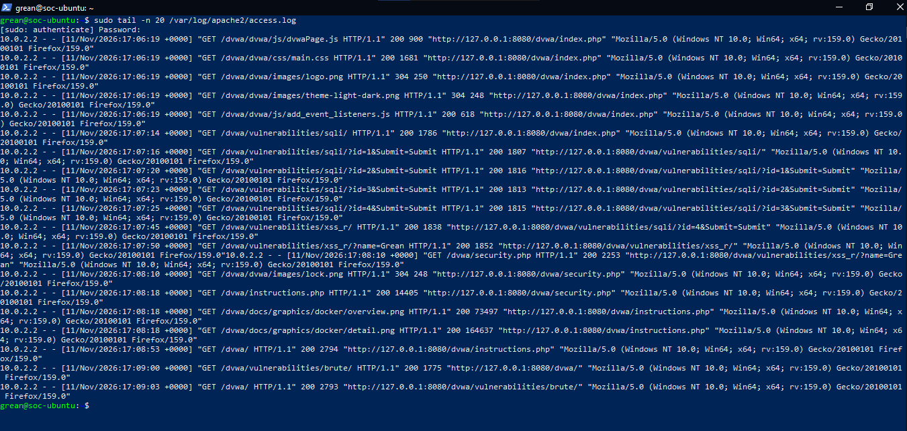
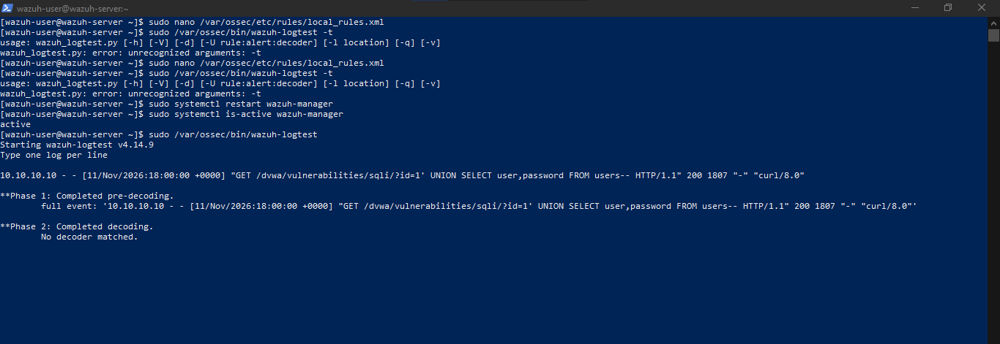
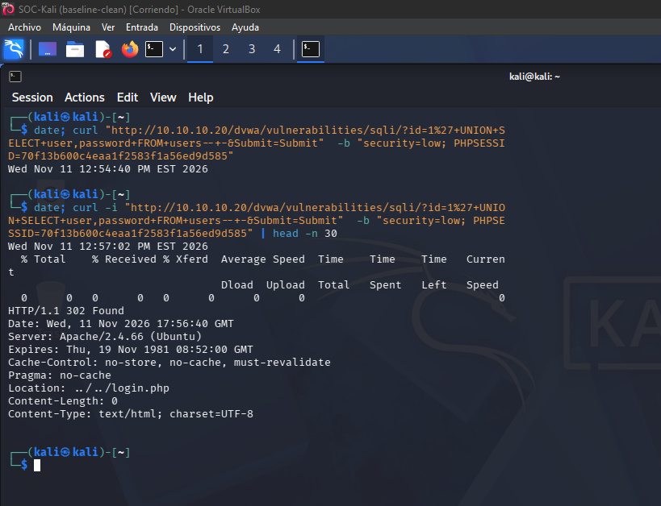
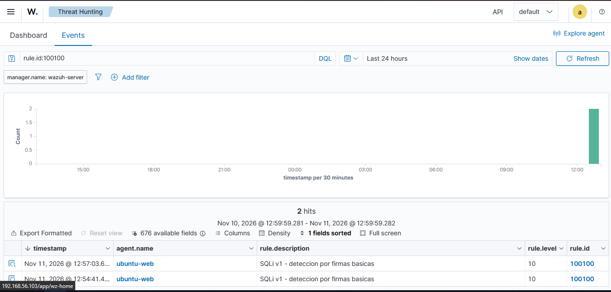
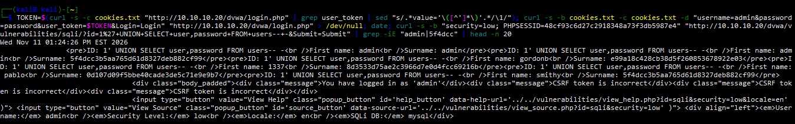
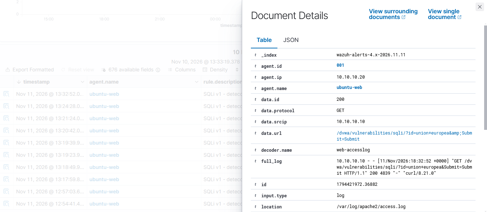
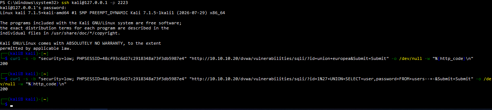
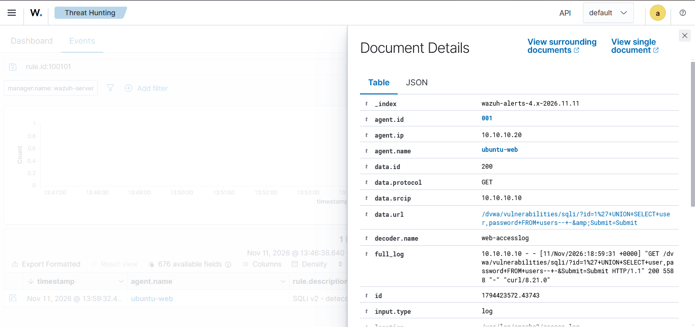

# Lab 08 — Writing and Tuning Custom SQLi Detection Rules in Wazuh

## Research question
An external attacker already has access to the DVWA web application. The SOC is told only
"there is weird traffic on the web server since yesterday." With Wazuh and nothing else, can
I write a detection rule that catches SQL injection (SQLi) in the Apache logs without
drowning the analyst in false positives? This lab is about the detection, not the attack:
I write a rule, attack to test it, measure its quality, find its defect, and fix it.

SQLi — SQL injection — is an attack where the user input is inserted into a database query,
so the attacker's text becomes executable SQL instead of data.

| Item | Result |
|---|---|
| Attack | SQLi against DVWA (`UNION SELECT` to dump the users table) |
| Custom rules written | 2 (`100100` naive, `100101` tuned) |
| Detection | Rule fired even when the attack itself failed |
| False positive found | A legitimate search (`union europea`) triggered rule v1 |
| Outcome | Rule v2 removed the false positive and kept the detection |
| Security+ objectives | 2.4, 4.4, 4.5 |

## Environment
Same isolated VirtualBox lab as Lab 07 (`SOC-LAB`, 10.10.10.0/24):

- **Kali** 10.10.10.10 — attacker.
- **Ubuntu Server** 10.10.10.20 — victim: Apache 2.4, PHP, MariaDB, DVWA at security level
  *low*, Wazuh agent `ubuntu-web` reading `/var/log/apache2/access.log`.
- **Wazuh** 10.10.10.30 — SIEM (manager, indexer, dashboard), v4.14.9.

Custom rules live on the manager in `/var/ossec/etc/rules/local_rules.xml`. The full file is
in this folder as `local_rules.xml`.

---

## Phase 1 — Baseline: what normal traffic looks like

Before writing a rule I generated normal DVWA traffic (SQL Injection page with `id=1`, `id=2`;
Reflected XSS with a name; ordinary navigation) and read the Apache log.

```bash
sudo tail -n 20 /var/log/apache2/access.log
```

A normal request decodes like this:

```
10.0.2.2 - - [11/Nov/2026:17:07:16 +0000] "GET /dvwa/vulnerabilities/sqli/?id=1&Submit=Submit HTTP/1.1" 200 1807 ...
```

| Field | Value | Meaning |
|---|---|---|
| source IP | `10.0.2.2` | who sent it |
| URL | `/dvwa/vulnerabilities/sqli/?id=1&Submit=Submit` | **what was requested** |
| status | `200` | OK |

The legitimate parameters are clean: `?id=1`, `?id=2`, `?name=Grean`. No quotes, no SQL
keywords. This is the baseline a rule has to be measured against: whatever I write must not
fire on traffic like this.



---

## Phase 2–3 — Detection design and rule v1

A SQLi payload such as `?id=1' UNION SELECT ... FROM users` differs from a normal request by
SQL-specific tokens a product name never contains: a single quote `'`, the keywords
`UNION`/`SELECT`/`OR`, and the comment marker `--`. My first rule (v1) matched any of these
on the decoded `url` field:

```xml
<rule id="100100" level="10">
  <if_group>web</if_group>
  <url>UNION|union|SELECT|select|%27</url>
  <description>SQLi v1 - deteccion por firmas basicas</description>
  <mitre><id>T1190</id></mitre>
</rule>
```

`%27` is the URL-encoded single quote `'`. `<if_group>web</if_group>` restricts the rule to
events already classified as web traffic, so it never evaluates SSH logs.

**A detour worth recording.** I first tried to validate the rule with `wazuh-logtest` by
pasting a raw log line. It returned `No decoder matched` and never reached the rule. The
reason: logtest had no Apache `log_format` context, so the decoder did not extract the `url`
field, and a rule cannot match a field that was never decoded. This is a real property of
Wazuh: a correct rule still does nothing if the decoder does not produce the field it reads.
I abandoned logtest and tested end-to-end against the live log instead.



---

## Phase 4 — Attack from Kali and first detection

I sent the SQLi from Kali with `curl`, so the source IP is the attacker's (10.10.10.10) and
the SOC story holds:

```bash
curl -s -b "security=low; PHPSESSID=..." \
  "http://10.10.10.20/dvwa/vulnerabilities/sqli/?id=1%27+UNION+SELECT+user,password+FROM+users--+-&Submit=Submit"
```

The payload decodes to `1' UNION SELECT user,password FROM users-- -`: close the original
query with `'`, append my own `SELECT` for the credentials table, and comment out the rest
with `-- -`.

The first attempts returned `HTTP/1.1 302 Found` → `Location: login.php`: DVWA redirected to
login, so the injection did **not** execute. `cat cookies.txt` showed why — the Kali session
carried `security=impossible`, DVWA's hardened level. (Browser and Kali are separate
sessions; the browser was `low`, Kali was not.) Forcing `security=low` in the request fixed
it.



**The detection fired anyway.** Even while the attack was being redirected and stealing
nothing, rule `100100` produced two alerts, because Wazuh reads the request in `access.log`
regardless of whether the attack succeeded. This is the point worth keeping: **detection is
independent of attack success — a SOC sees the attempt, not only the breach.**



Once the session was corrected, the same payload dumped the users table:

```
admin   : 5f4dcc3b5aa765d61d8327deb882cf99
gordonb : e99a18c428cb38d5f260853678922e03
1337    : 8d3533d75ae2c3966d7e00d4fcc69216b
pablo   : 0d107d09f5bbe40cade3de5c71e9e9b7
smithy  : 5f4dcc3b5aa765d61d8327deb882cf99
```

`admin` and `smithy` share the same hash: both use the password "password". That is only
visible because the hashes are unsalted MD5 — identical passwords produce identical hashes.
A salt would have made them differ. (Good follow-up for a later lab: crack these with John
the Ripper to show why unsalted MD5 is weak.)



---

## Phase 5 — Measuring the rule, and why v1 was not good enough

A rule that fires on an attack is not the same as a good rule. I measured false positives by
sending a **legitimate** search that happens to contain a keyword:

```bash
curl ... "http://10.10.10.20/dvwa/vulnerabilities/sqli/?id=union+europea&Submit=Submit"
```

`union europea` is an innocent search, HTTP 200, no attack. Rule v1 fired on it anyway,
because it matches the single word `union`. That is a **false positive**.



| Request | Legitimate? | Rule v1 |
|---|---|---|
| `1' UNION SELECT ...` | no (attack) | fires (correct) |
| `union europea` | yes | fires (**false positive**) |

The defect: v1 bans single keywords, not combinations. A noisy rule causes alert fatigue —
an analyst buried in false alerts starts ignoring all of them, including the real one.

### Rule v2 — match the combination, not the word

Rule v2 requires two attack elements together, and ignores case so `UnIoN sElEcT` can't
evade it:

```xml
<rule id="100101" level="12">
  <if_group>web</if_group>
  <match type="pcre2">(?i)(union.+select|or.+1=1|'.+(or|and).+=)</match>
  <description>SQLi v2 - deteccion por combinacion de patrones</description>
  <mitre><id>T1190</id></mitre>
</rule>
```

- `(?i)` — case-insensitive, covers `UNION`, `union`, `UnIoN`.
- `union.+select` — `union`, then one or more of **anything** (space, URL-encoded space, or a
  `/**/` comment used for evasion), then `select`. `union europea` has no `select` after it,
  so it does not match.
- `<match type="pcre2">` applies the regex to the event; `<match>` accepts `type`, unlike the
  static `<url>` field.

**Error and correction (real).** v2 did not load on the first three tries, and the manager
refused to start each time — which is the safe behaviour, it validates the XML on restart:

1. `<pcre2>...</pcre2>` → `Invalid option 'pcre2' for rule`. There is no such tag.
2. `<url type="pcre2">` with the rule outside any `<group>` → `Invalid root element "rule". Only "group" is allowed`. Every rule must sit inside a `<group>`.
3. `<field name="url" type="pcre2">` → `Field 'url' is static`. `url` is a predefined field and cannot be redefined as a regex field.
4. `<match type="pcre2">` inside a `<group>` → loaded, manager `active`.

I kept this sequence because it is how the rule was actually built, not how I wish it had gone.

### v2 result

Sending both requests again, only the real attack produced an alert (rule `100101`,
`srcip 10.10.10.10`, `data.url` showing the `UNION SELECT`). The `union europea` search
produced nothing.




| Request | Rule v1 | Rule v2 |
|---|---|---|
| `1' UNION SELECT ...` (attack) | fires | fires |
| `union europea` (legitimate) | **false positive** | ignored |

Tuning the rule removed the false positive without introducing a false negative: it still
catches the attack.

---

## MITRE ATT&CK
| Tactic | Technique | Evidence |
|---|---|---|
| Initial Access | T1190 Exploit Public-Facing Application | `UNION SELECT` in `access.log`, credentials dumped |

## Security+ SY0-701 objectives
- **2.4** Analyze indicators of malicious activity — SQLi signatures in web logs.
- **4.4** Security alerting and monitoring — writing and tuning SIEM detection rules.
- **4.5** Modify enterprise capabilities to enhance security — custom detection content.

## Limitations and lessons
- **Signature detection is evadable.** Rule v2 is better than v1, not unbreakable. Double
  URL-encoding, hex payloads, or blind SQLi (`AND SLEEP(5)` with no `UNION`/`SELECT`) would
  bypass it. In a real environment this is paired with behavioural detection and a WAF.
- **Detection is not prevention.** The rule is a *detective* control. SQLi is *prevented* at
  the source with prepared statements (parameterized queries), input validation, and least
  privilege on the database account.
- **False positives cause false negatives.** A noisy rule isn't just annoying; fatigue makes
  the analyst miss the real alert. Tuning is a security control, not a convenience.
- The lab uses DVWA at *low* and intentionally weak settings; it is not a production config.

## Files
- `local_rules.xml` — the two rules, commented.
- `screenshots/` — evidence for each phase.
